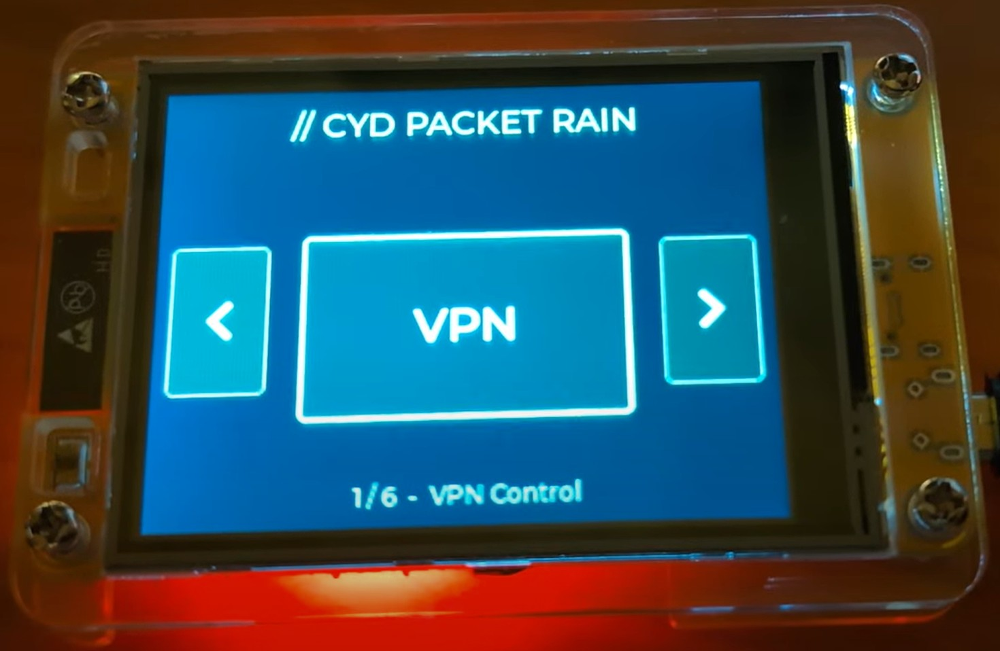
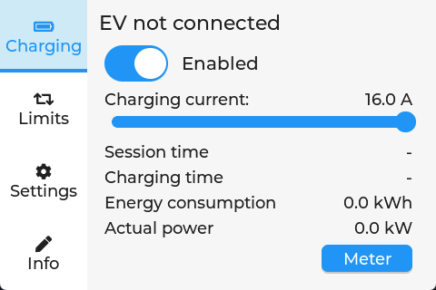
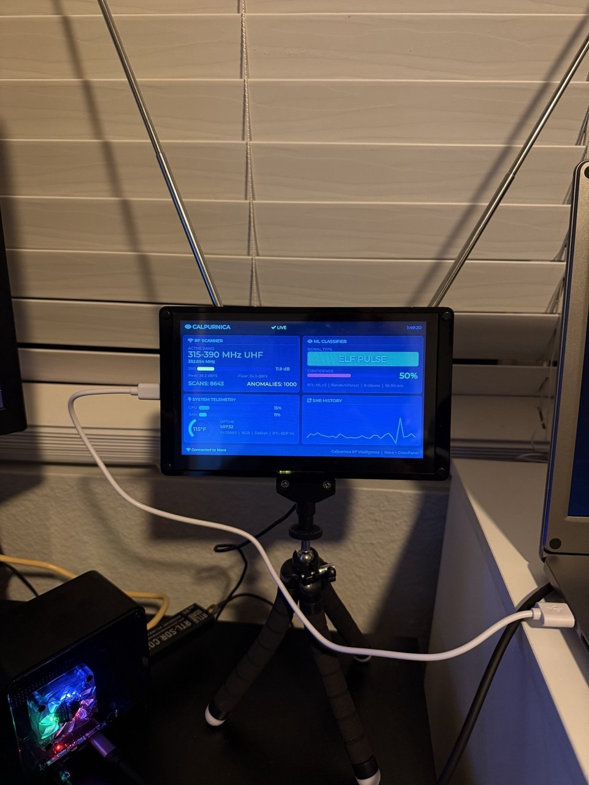
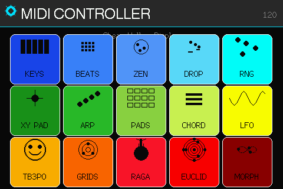
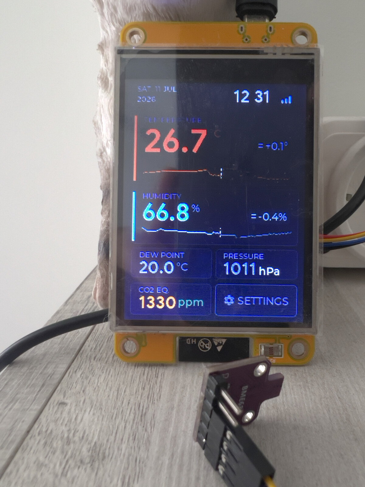
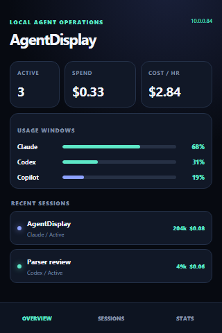
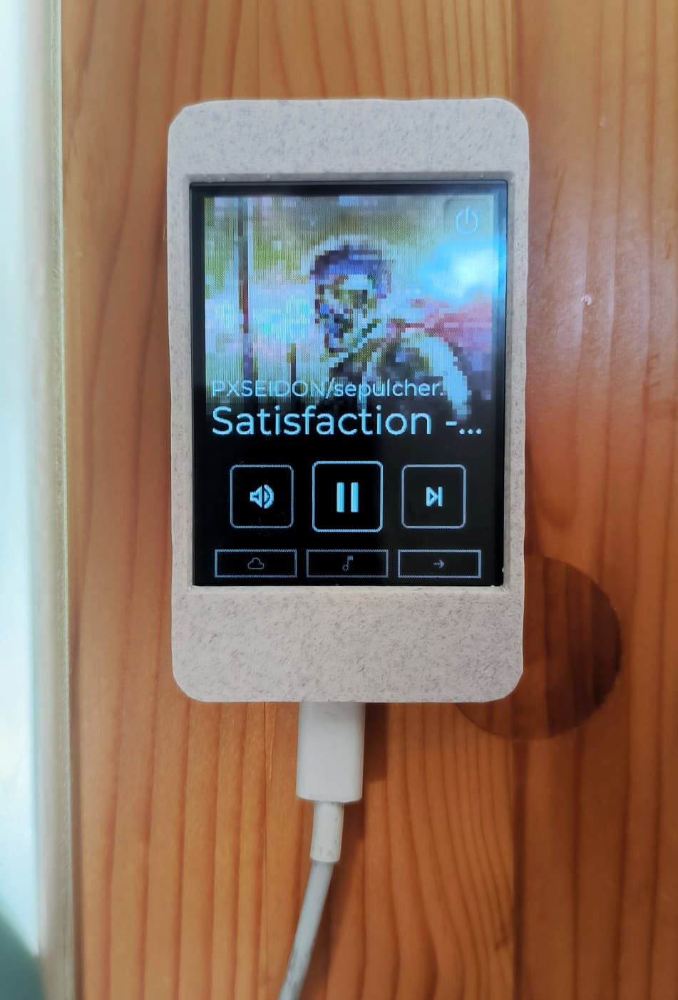
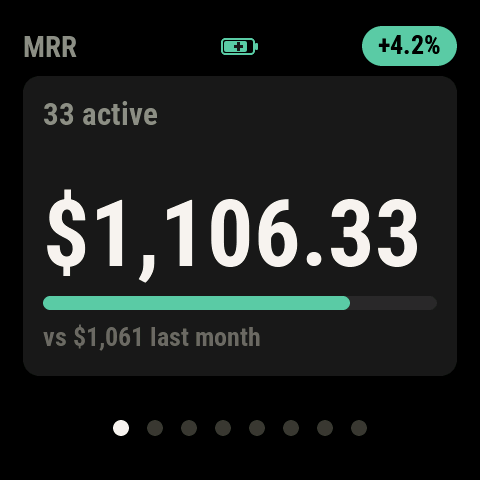
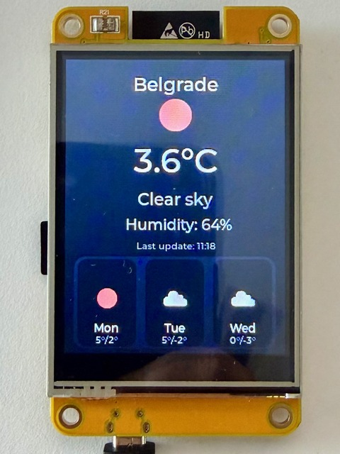

# ESP32 LVGL 界面专题图鉴

这里收录 **9 个适合 ESP32 系列参考的 LVGL 项目**，每项都有上游图片、项目源码快照、许可证与版本记录。照片和效果图展示的是上游项目，具体板卡及功能见下表。

> 本次整理核对了源码和资料，但没有编译、运行或实机测试。ESPHome 项目的界面以 YAML 配置提供；其他示例所需的框架、库或服务需按上游文档安装。代码许可不一定覆盖所有图片、字体、图标及第三方依赖。

## 快速挑选

| 项目 | 开发板、技术与条件 | 许可 |
| --- | --- | --- |
| [CYD 网络天气与状态屏](lvgl/ESP32-CYD-Packet-Rain/) | ESP32-2432S028 / 320×240 / LVGL 8.3.11 / PlatformIO；天气及路由器功能需自行配置网络和服务 | MIT |
| [充电桩触摸控制面板](lvgl/ESP32-EVSE-HMI/) | ESP32 系列 / ESPHome + LVGL；界面源码为 YAML 配置，需 ESP32-EVSE 控制器和对应屏幕 | MIT |
| [SDR 设备与频谱状态面板](lvgl/ESP32-CrowView-SDR/) | ESP32-S3 CrowPanel 7 英寸 / 800×480 / LVGL 8.3 / PlatformIO；动态数据需外接 Linux SBC 和 SDR | MIT |
| [触屏 MIDI 控制器](lvgl/ESP32-aCYD-MIDI/) | ESP32 CYD / PlatformIO；支持菜单、音序器和 XY 触控；LVGL 版本由依赖确定，需按上游核对 | MIT |
| [温湿度与空气质量监测站](lvgl/ESP32-SensorStation3/) | ESP32-2432S028 / ESP-IDF 6.0.2 / LVGL 9.5；可选 Bosch BSEC 不随上游分发，需单独获取 | Apache-2.0 |
| [320×480 状态和会话看板](lvgl/ESP32-AgentScreen/) | ESP32 E32R40T / ST7796S / LVGL 8.4 / PlatformIO；截图为设计预览，项目还含 .NET 服务 | MIT |
| [触屏音乐遥控器](lvgl/ESP32-CYD-Jukebox/) | ESP32-2432S028 / ESPHome + LVGL；需 Home Assistant 和 AppDaemon；上游建议 ESPHome 2026.3 或更早 | MIT |
| [圆角数据指标看板](lvgl/ESP32-Stripe-Metrics/) | ESP32-C6 / 480×480 AMOLED / LVGL 9.2 / PlatformIO；应用数据需 Stripe 服务，图为界面参考 | MIT |
| [独立天气站](lvgl/ESP32-Weather-Station/) | ESP32 / ILI9341 2.8 英寸 240×320 / LVGL 8.3.11 / PlatformIO；天气服务和 Wi-Fi 需自行配置 | MIT |

## 界面预览与源码

### CYD 网络天气与状态屏

图片类型：上游实机菜单照片。ESP32-2432S028 / 320×240 / LVGL 8.3.11 / PlatformIO；天气及路由器功能需自行配置网络和服务。

[查看本仓库源码](lvgl/ESP32-CYD-Packet-Rain/) · [上游项目](https://github.com/Buzzcola81/cyd-packet-rain) · 许可证：MIT

### 充电桩触摸控制面板

图片类型：上游效果动画。ESP32 系列 / ESPHome + LVGL；界面源码为 YAML 配置，需 ESP32-EVSE 控制器和对应屏幕。

[查看本仓库源码](lvgl/ESP32-EVSE-HMI/) · [上游项目](https://github.com/nagyrobi/esp32evse_esphome-lvgl) · 许可证：MIT

### SDR 设备与频谱状态面板

图片类型：上游实机照片。ESP32-S3 CrowPanel 7 英寸 / 800×480 / LVGL 8.3 / PlatformIO；动态数据需外接 Linux SBC 和 SDR。

[查看本仓库源码](lvgl/ESP32-CrowView-SDR/) · [上游项目](https://github.com/TrevTron/crowview-cyberdeck) · 许可证：MIT

### 触屏 MIDI 控制器

图片类型：上游实际屏幕截图（BMP 转 PNG 展示）。ESP32 CYD / PlatformIO；支持菜单、音序器和 XY 触控；LVGL 版本由依赖确定，需按上游核对。

[查看本仓库源码](lvgl/ESP32-aCYD-MIDI/) · [上游项目](https://github.com/julesdg6/aCYD-MIDI) · 许可证：MIT

### 温湿度与空气质量监测站

图片类型：上游实机照片。ESP32-2432S028 / ESP-IDF 6.0.2 / LVGL 9.5；可选 Bosch BSEC 不随上游分发，需单独获取。

[查看本仓库源码](lvgl/ESP32-SensorStation3/) · [上游项目](https://github.com/ScorpionZZZ/SensorStation3) · 许可证：Apache-2.0

### 320×480 状态和会话看板

图片类型：上游设计预览图。ESP32 E32R40T / ST7796S / LVGL 8.4 / PlatformIO；截图为设计预览，项目还含 .NET 服务。

[查看本仓库源码](lvgl/ESP32-AgentScreen/) · [上游项目](https://github.com/JerrettDavis/AgentScreen) · 许可证：MIT

### 触屏音乐遥控器

图片类型：上游设备照片。ESP32-2432S028 / ESPHome + LVGL；需 Home Assistant 和 AppDaemon；上游建议 ESPHome 2026.3 或更早。

[查看本仓库源码](lvgl/ESP32-CYD-Jukebox/) · [上游项目](https://github.com/TheDiffi/cyd-jukebox) · 许可证：MIT

### 圆角数据指标看板

图片类型：上游固件界面渲染图。ESP32-C6 / 480×480 AMOLED / LVGL 9.2 / PlatformIO；应用数据需 Stripe 服务，图为界面参考。 此快照不含上游 Stripe 密钥测试文件（被 GitHub 推送保护拦截），可在上游仓库查看。

[查看本仓库源码](lvgl/ESP32-Stripe-Metrics/) · [上游项目](https://github.com/cosjef/stripe-business-metrics-monitor) · 许可证：MIT

### 独立天气站

图片类型：上游实机显示照片。ESP32 / ILI9341 2.8 英寸 240×320 / LVGL 8.3.11 / PlatformIO；天气服务和 Wi-Fi 需自行配置。

[查看本仓库源码](lvgl/ESP32-Weather-Station/) · [上游项目](https://github.com/dcoric/weather-station) · 许可证：MIT

## 移植时先看

1. 先检查目标芯片、屏幕分辨率、显示与触摸驱动、PSRAM 和引脚；ESP32、ESP32-S3、ESP32-C6 的板级配置不能直接互换。
2. 注意 LVGL 8 与 LVGL 9 的接口差异；项目可能依赖 PlatformIO、ESP-IDF、ESPHome 或外部服务，不保证开箱即用。
3. 项目快照及上游固定提交见 [sources.json](sources.json)；需要第三方库、子模块或闭源组件时，以各项目的 README 为准。Wi-Fi、API 密钥应自行配置。

## 上游参考（未收录素材）

[中文家居控制面板](https://github.com/lo-ferris/esp32-lvgl9-home-panel)：ESP32-S3、LVGL 9.5、多页面家居界面，作者提供效果图和源码；部分咖啡图片素材来自其他项目，授权需要进一步核实，因此此处仅提供上游链接。

[返回 Qt / LVGL 图鉴](UI图鉴.md) · [返回首页](README.md)
