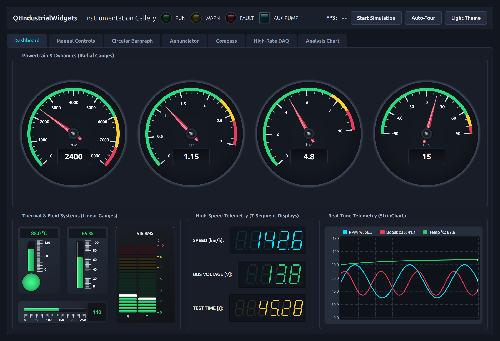
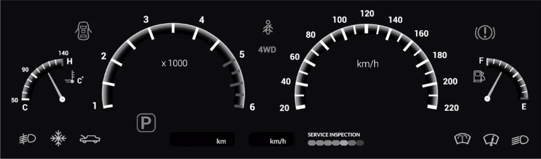
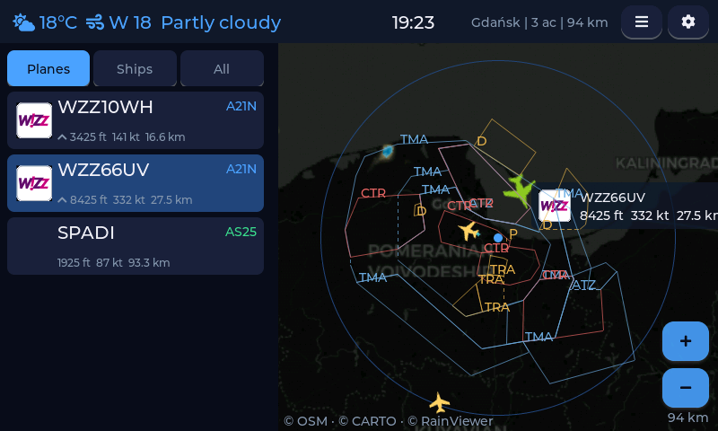
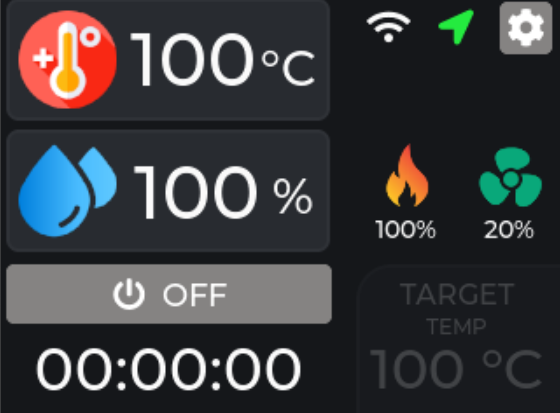

# Qt / LVGL 开源 UI 参考库

收集可以阅读源码的界面成品和项目快照，便于后续制作上位机、嵌入式人机界面、设备面板和仪表盘。每个项目保持上游原始目录与许可证；快照版本和来源见 [sources.json](sources.json)。

> 本仓库是第三方项目的学习资料整理，并非这些项目的原作者。当前只核对了源码、说明及许可证，**没有编译、运行或实机验证**。使用时请检查上游更新、依赖及各项目的许可证；第三方字体、图片、图标等可能有单独的授权条件。

## 项目一览

| 类型 | 项目 | 界面与适用场景 | 技术栈和条件 | 许可证 |
| --- | --- | --- | --- | --- |
| Qt | [DevicePilotHMI](qt/DevicePilotHMI/) | 工业设备模拟 HMI：仪表、趋势图、报警、日志和设置 | Qt Quick / QML，Qt 6.11+，C++20，CMake 3.25+ | MIT |
| Qt | [QtIndustrialWidgets](qt/QtIndustrialWidgets/) | 工业仪表、图表和控件 Gallery 展示程序，附多张界面截图 | Qt 6 / C++17；是控件库和演示程序，不是完整生产系统 | MIT；部分资源有单独声明 |
| Qt | [Dashboard](qt/Dashboard/) | 汽车仪表盘：车速、档位、背景和倒车视图，可参考仪表布局 | C++ / QML；上游标注 Qt 5.12、5.15.2 | MIT |
| LVGL | [LVGL-Car-Dashboard](lvgl/LVGL-Car-Dashboard/) | 多页面车载界面：仪表、媒体、导航和控制页；有 PC 与 ESP32 版本 | LVGL 8.3；PC 需 SDL2、LVGL 源码及另行生成的中文字体；ESP32-S3 版本使用 ST7789V 和 ESP-IDF | MIT |
| LVGL | [ESP32-LVGL-Thermostat](lvgl/ESP32-LVGL-Thermostat/) | 温控仪表、滑块和智能家居交互，适合参考单页设备面板 | LVGL 8.3，ESP32、320×240 ILI9341、PlatformIO；MQTT 功能需配套服务 | MIT |
| LVGL | [esp32flight](lvgl/esp32flight/) | 飞行雷达、信息卡片、地图等多页面设备界面，附截图 | LVGL 8、ESP-IDF 5.5+；支持多种 ESP32 显示板，依赖外部数据及资源 | MIT；地图、标识等第三方内容另有要求 |
| LVGL | [DIY-Filament-Dryer](lvgl/DIY-Filament-Dryer/) | 温湿度、风扇和加热控制界面，附 EEZ Studio 设计文件和生成源码 | LVGL 9.1 系列、ESP32、PlatformIO；传感器和联网功能依赖相应硬件 | MIT |

## 图片预览

### Qt 工业仪表盘和控件 Gallery

上图来自 [QtIndustrialWidgets](qt/QtIndustrialWidgets/) 上游项目，页面是组件展示程序。还可以查看 [手动控制](qt/QtIndustrialWidgets/docs/images/tab-manual-controls.png) 和 [数据采集](qt/QtIndustrialWidgets/docs/images/tab-daq.png) 页面。

### Qt 汽车仪表

上图是 [Dashboard](qt/Dashboard/) 自带的仪表**底图**，运行时还会叠加动态控件。

### LVGL 航空雷达

上图来自 [esp32flight](lvgl/esp32flight/)；其上游还提供 [航班详情](lvgl/esp32flight/docs/detail.png) 和 [复古雷达](lvgl/esp32flight/docs/retro.png) 界面截图。地图及航空数据涉及第三方来源，使用时参照上游说明。

### LVGL 烘料控制器

上图来自 [DIY-Filament-Dryer](lvgl/DIY-Filament-Dryer/)。

**暂未找到上游截图：** DevicePilotHMI、LVGL-Car-Dashboard 和 ESP32-LVGL-Thermostat 已收录源码，但本库未对它们伪造效果图。

## 建议阅读顺序

1. 先看各项目的 `README`，确认界面用途、版本和依赖，再找 UI 相关源码。
2. Qt 项目重点看 `qml/`、QML 控件、资源文件以及 C++ 与 QML 的交互；Qt 5 与 Qt 6 项目分别参考。
3. LVGL 航空雷达先看 `main/` 和 `docs/`；车载项目先看 `lvgl_dashboard/ui/` 的多页面布局；恒温器看 `src/`；烘料控制器看 `src/ui/` 和 `myapp.eez-project`。
4. 移植前确认显示分辨率、色深、触摸驱动、内存、LVGL 大版本、目标芯片和编译环境，不能直接假定适配自己的硬件。
5. 各项目可能需要按其文档下载依赖、生成缺失字体或修改板级配置。联网和硬件配置请使用自己的测试环境，勿提交真实密码。

## 来源与快照

| 本地目录 | 上游项目 | 固定版本 |
| --- | --- | --- |
| `qt/DevicePilotHMI` | [cequnyang/DevicePilotHMI](https://github.com/cequnyang/DevicePilotHMI) | `19b8d165798ed2468f69cc6401f2d31b92086ea6` |
| `qt/QtIndustrialWidgets` | [paolosereno/QtIndustrialWidgets](https://github.com/paolosereno/QtIndustrialWidgets) | `cc7ad610b14982cf9ed740eff9ff74cf8aed85ac` |
| `qt/Dashboard` | [jpavlek/Dashboard](https://github.com/jpavlek/Dashboard) | `4e597651213aa82b5878b74c6349f110a9223164` |
| `lvgl/LVGL-Car-Dashboard` | [codeempereor/LVGL-Car-Dashboard](https://github.com/codeempereor/LVGL-Car-Dashboard) | `cf29121298c40cb4ba2966180071d1ecc0418a91` |
| `lvgl/ESP32-LVGL-Thermostat` | [zetapersei/ESP32_LVGL_Thermostat_Panel](https://github.com/zetapersei/ESP32_LVGL_Thermostat_Panel) | `bdd4333081e685d3ab983c32b8b9243b55dd46ee` |
| `lvgl/esp32flight` | [theqkash/esp32flight](https://github.com/theqkash/esp32flight) | `da06b177bcc4002ba32b6f3e4f08a0fc5eed432a` |
| `lvgl/DIY-Filament-Dryer` | [itarozzi/diy_filament_dryer](https://github.com/itarozzi/diy_filament_dryer) | `a9f9d3ee061b6af0d7c692db0b6e3a38b808bcdd` |

项目源码以快照形式存放，原仓库的 Git 历史未并入；要获取更新或完整历史，请访问对应上游。仓库中的第三方项目分别依据各自 `LICENSE` 授权，不因本索引改变原许可证。
