# Qt / LVGL 开源界面图鉴

共收录 **22 个有图片的项目或组件**：Qt 10 项，LVGL 12 项。点“查看源码”进入本仓库快照，点“上游项目”查看原作者说明及更新。

> 图片来自对应上游，可能是实机照片、模拟器截图或设计稿；每项标出类型。本库本次只核对源码与资料，未编译、运行或实机验证。代码、字体、图标、数据与商标可能受不同许可约束；复制或商用前请检查对应目录的 LICENSE 与第三方声明。

## 快速导航

| 分类 | 界面 | 技术及限制 | 许可证 |
| --- | --- | --- | --- |
| Qt | [Qt 工业仪表与控件展示](qt/QtIndustrialWidgets/) | Qt 6 / C++17；组件图库和示例 | MIT / 第三方素材另见上游 |
| Qt | [Qt 汽车仪表](qt/Dashboard/) | Qt 5 / QML；图片为界面底图，运行时会叠加动态控件 | MIT |
| LVGL | [航空雷达信息屏](lvgl/esp32flight/) | ESP32-S3 / LVGL 8；地图与数据涉及第三方来源 | MIT / 第三方素材另见上游 |
| LVGL | [温湿度与烘料控制](lvgl/DIY-Filament-Dryer/) | ESP32 / LVGL 9.1；含 EEZ Studio 设计文件 | MIT |
| Qt | [电池管理双 BMS 界面](qt/BmsDashboard/) | QML 插件；依赖 Victron Venus OS GUIv2 和 dbus-serialbattery | MIT |
| Qt | [树莓派家庭环境监控](qt/RPi-Dashboard/) | Qt/QML；需树莓派和上游环境数据接入 | MIT |
| Qt | [模拟指针仪表](qt/S5W-Dial-QML/) | Qt 5 / QML；仪表组件及示例，包含符号链接 | MIT |
| Qt | [中文工业生产看板](qt/PyQt-Dashboard/) | PyQt5 桌面示例；不包含上游预编译 EXE | MIT |
| Qt | [桌面系统监控小组件](qt/PyQt-System-Monitor/) | PyQt6 / Windows；桌面应用 | MIT |
| Qt | [智能家居控制界面](qt/Smarton/) | Qt 6.8 / QML / C++20；图为设计稿，不表示各页面均已实现 | MIT |
| Qt | [工业设备监控、趋势与报警](qt/Industrial-Equipment-Monitor/) | Qt 6 / C++17；上游截图使用模拟数据 | MIT |
| Qt | [串口监控与曲线界面](qt/Qt-Serial-Monitor/) | Qt 6.11 / C++17；上游使用信号发生器，真实串口未接入 | MIT |
| LVGL | [多页面汽车仪表与诊断](lvgl/Car-Dashboard-CYD/) | LVGL 9 / ESP32 CYD；真实车辆通信仍待上游实现；复用需遵守 GPL-3.0 | GPL-3.0 |
| LVGL | [家居信息与天气屏](lvgl/Waveshare-Home-Dashboard/) | ESP32 / LVGL 8.4；EEZ Studio 设计及生成代码；运行依赖对应板卡和服务 | MIT |
| LVGL | [墨水屏天气与日历](lvgl/E-Ink-Dashboard/) | ESP32-S3 / LVGL 9.2 / 5.79 英寸墨水屏；天气新闻依赖网络服务 | MIT |
| LVGL | [仪表卡片及酿造控制多页面](lvgl/LVGL-MCP-Examples/) | LVGL 9.6 模拟工具和 JSON 示例；子模块未包含，图片为模拟器渲染 | MIT |
| LVGL | [圆屏天气、雷达与家庭数据](lvgl/ESP32-Sky-Gauge/) | ESP32-S3 / 1.28 英寸圆屏；外部 API 与配置需自行准备 | MIT |
| LVGL | [像素风桌面状态看板](lvgl/TokenTide/) | ESPHome / LVGL；需适配设备和数据来源 | MIT |
| LVGL | [多主题智能家居面板](lvgl/M5-Tab5-Home/) | M5Stack Tab5 / ESPHome / LVGL；图库图片多为 CI 渲染，字体有独立许可证 | MIT |
| LVGL | [音乐播放控制面板](lvgl/YT-Music-Companion/) | ESP32-S3 / LVGL 9.5 / ESP-IDF；控制 YouTube Music，非离线播放器 | MIT |
| LVGL | [智能手表表盘、天气与应用](lvgl/Smartwatch-ESP32/) | ESP32-S3 / LVGL 9.6 / Arduino；面向 Waveshare 1.8 英寸 AMOLED | MIT |
| LVGL | [小组件、键盘与设置页](lvgl/CYD-Dashboard/) | ESP32 CYD / LVGL；板级子模块未包含，参见上游 | MIT |

## Qt 图鉴

### Qt 工业仪表与控件展示

**图片：**上游 Gallery 截图。**说明：**Qt 6 / C++17；组件图库和示例。**许可证：**MIT / 第三方素材另见上游。

[查看源码](qt/QtIndustrialWidgets/) · [上游项目](https://github.com/paolosereno/QtIndustrialWidgets)

### Qt 汽车仪表

**图片：**上游界面底图。**说明：**Qt 5 / QML；图片为界面底图，运行时会叠加动态控件。**许可证：**MIT。

[查看源码](qt/Dashboard/) · [上游项目](https://github.com/jpavlek/Dashboard)

### 电池管理双 BMS 界面

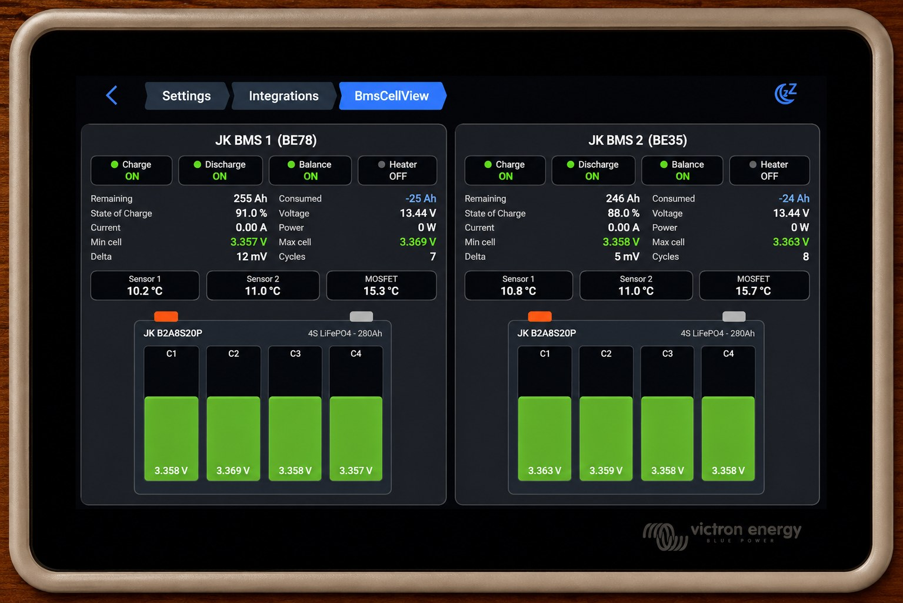

**图片：**上游界面照片。**说明：**QML 插件；依赖 Victron Venus OS GUIv2 和 dbus-serialbattery。**许可证：**MIT。

[查看源码](qt/BmsDashboard/) · [上游项目](https://github.com/jhehenri/BmsDashboard)

### 树莓派家庭环境监控

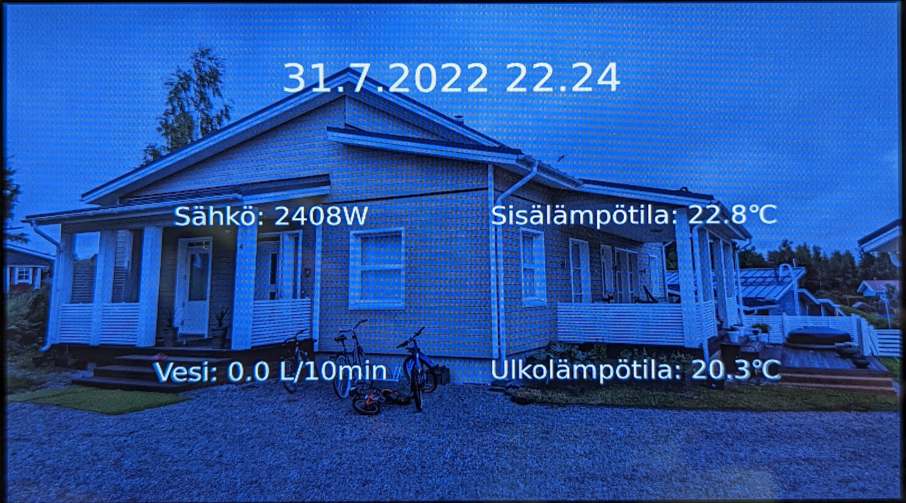

**图片：**上游设备画面照片。**说明：**Qt/QML；需树莓派和上游环境数据接入。**许可证：**MIT。

[查看源码](qt/RPi-Dashboard/) · [上游项目](https://github.com/ledimies/rpi-dashboard)

### 模拟指针仪表

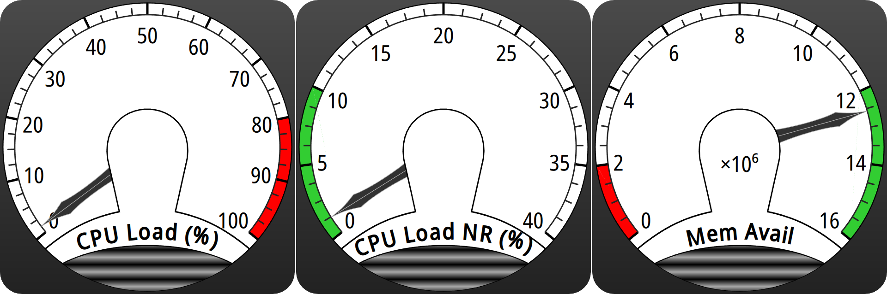

**图片：**上游组件示例截图。**说明：**Qt 5 / QML；仪表组件及示例，包含符号链接。**许可证：**MIT。

[查看源码](qt/S5W-Dial-QML/) · [上游项目](https://github.com/purinchu/s5w-dial-qml)

### 中文工业生产看板

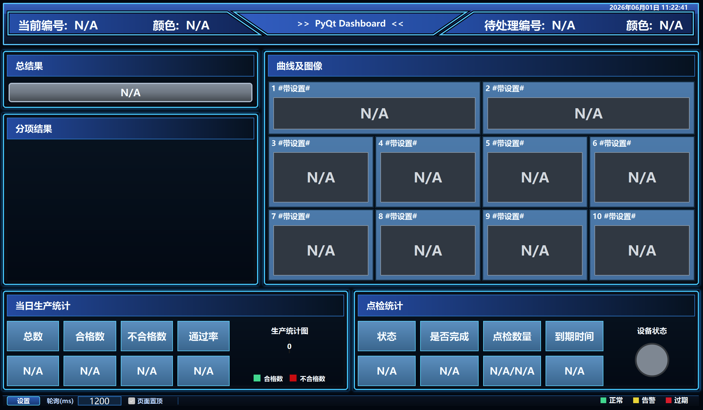

**图片：**上游示例截图。**说明：**PyQt5 桌面示例；不包含上游预编译 EXE。**许可证：**MIT。

[查看源码](qt/PyQt-Dashboard/) · [上游项目](https://github.com/JC-qq897888271/pyqt-dashboard-template)

### 桌面系统监控小组件

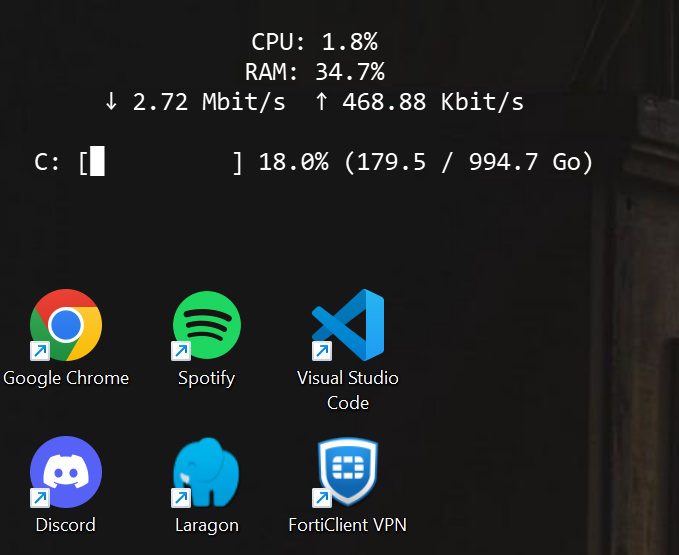

**图片：**上游示例截图。**说明：**PyQt6 / Windows；桌面应用。**许可证：**MIT。

[查看源码](qt/PyQt-System-Monitor/) · [上游项目](https://github.com/Littl3T/Minimalist-Windows-System-Monitor-Widget-PyQt6-)

### 智能家居控制界面

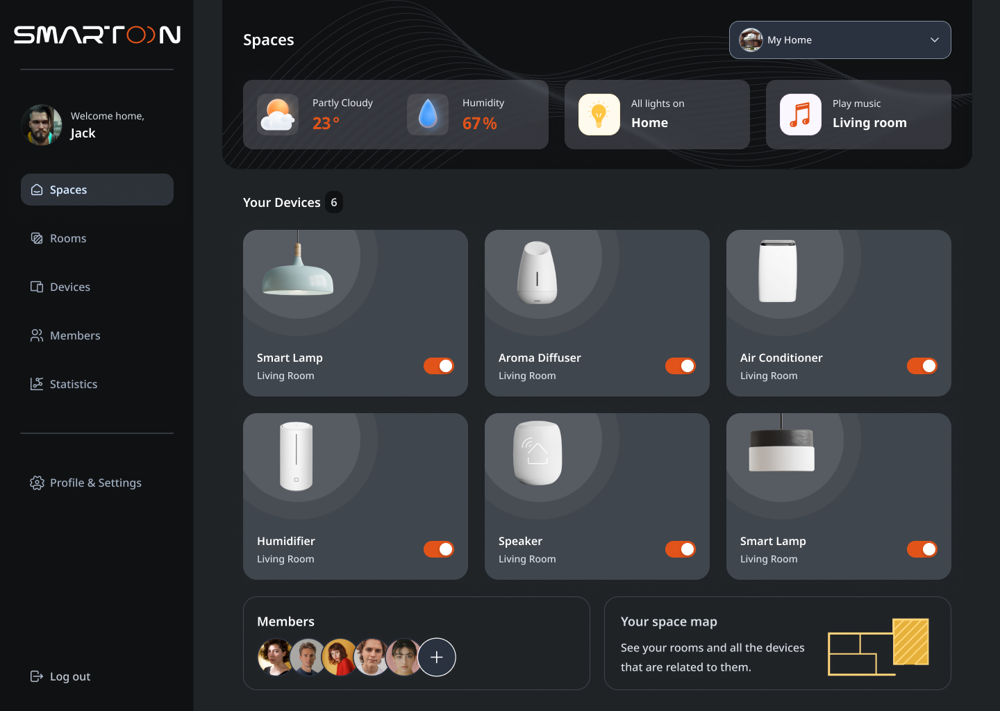

**图片：**上游 Figma 导出设计稿。**说明：**Qt 6.8 / QML / C++20；图为设计稿，不表示各页面均已实现。**许可证：**MIT。

[查看源码](qt/Smarton/) · [上游项目](https://github.com/divyadesh/Smarton)

### 工业设备监控、趋势与报警

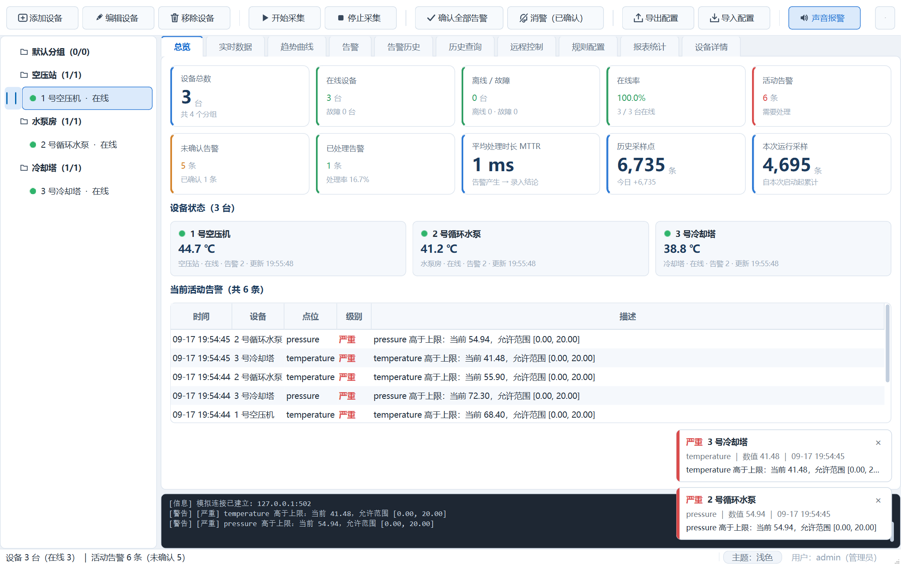

**图片：**模拟数据运行截图。**说明：**Qt 6 / C++17；上游截图使用模拟数据。**许可证：**MIT。

[查看源码](qt/Industrial-Equipment-Monitor/) · [上游项目](https://github.com/Y71jj123/qt-industrial-equipment-monitor)

### 串口监控与曲线界面

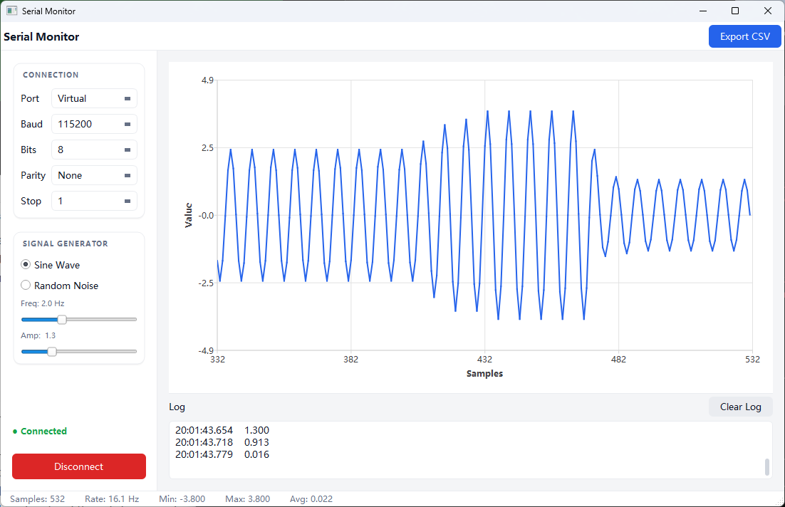

**图片：**模拟数据示例截图。**说明：**Qt 6.11 / C++17；上游使用信号发生器，真实串口未接入。**许可证：**MIT。

[查看源码](qt/Qt-Serial-Monitor/) · [上游项目](https://github.com/chxii/qt-serial-monitor)

## LVGL 图鉴

### 航空雷达信息屏

**图片：**上游界面截图。**说明：**ESP32-S3 / LVGL 8；地图与数据涉及第三方来源。**许可证：**MIT / 第三方素材另见上游。

[查看源码](lvgl/esp32flight/) · [上游项目](https://github.com/theqkash/esp32flight)

### 温湿度与烘料控制

**图片：**上游界面截图。**说明：**ESP32 / LVGL 9.1；含 EEZ Studio 设计文件。**许可证：**MIT。

[查看源码](lvgl/DIY-Filament-Dryer/) · [上游项目](https://github.com/itarozzi/diy_filament_dryer)

### 多页面汽车仪表与诊断

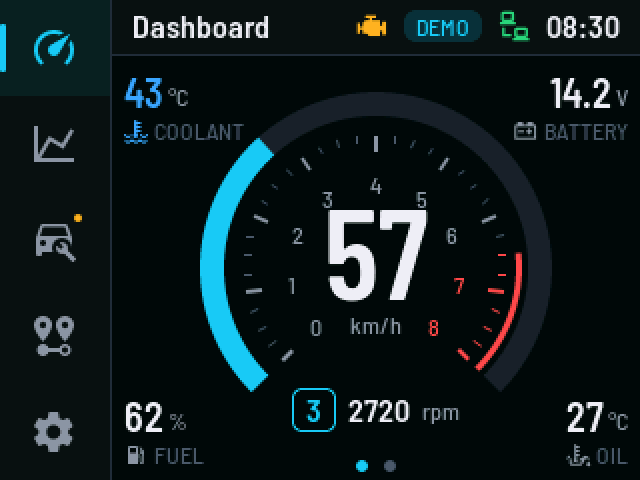

**图片：**上游界面截图。**说明：**LVGL 9 / ESP32 CYD；真实车辆通信仍待上游实现；复用需遵守 GPL-3.0。**许可证：**GPL-3.0。

[查看源码](lvgl/Car-Dashboard-CYD/) · [上游项目](https://github.com/muki01/Car-Dashboard-ESP32-CYD)

### 家居信息与天气屏

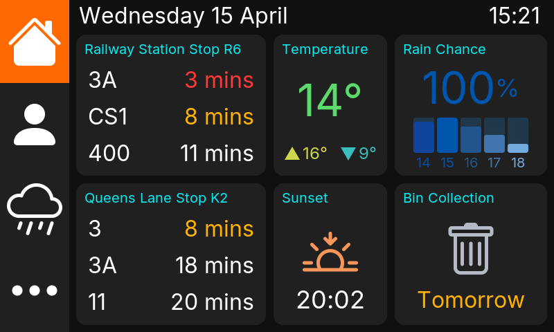

**图片：**上游界面动画。**说明：**ESP32 / LVGL 8.4；EEZ Studio 设计及生成代码；运行依赖对应板卡和服务。**许可证：**MIT。

[查看源码](lvgl/Waveshare-Home-Dashboard/) · [上游项目](https://github.com/davweb/waveshare-home-dashboard)

### 墨水屏天气与日历

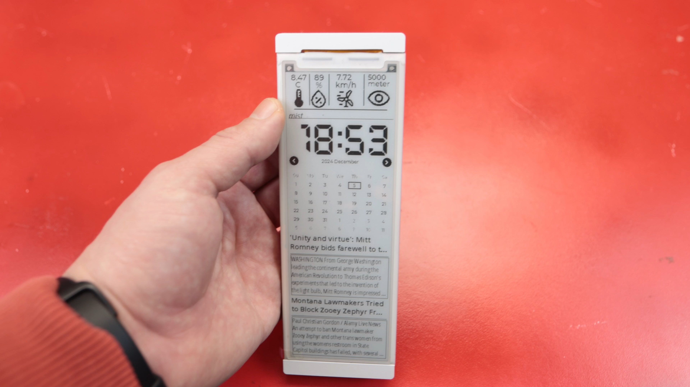

**图片：**上游设备界面照片。**说明：**ESP32-S3 / LVGL 9.2 / 5.79 英寸墨水屏；天气新闻依赖网络服务。**许可证：**MIT。

[查看源码](lvgl/E-Ink-Dashboard/) · [上游项目](https://github.com/MakersFunDuck/5.79-inch-E-ink-dashboard-with-LVGL-9)

### 仪表卡片及酿造控制多页面

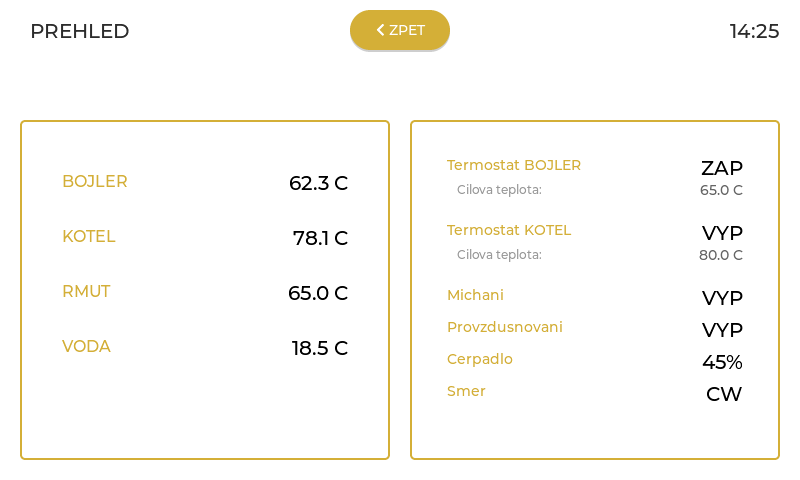

**图片：**上游模拟器渲染图。**说明：**LVGL 9.6 模拟工具和 JSON 示例；子模块未包含，图片为模拟器渲染。**许可证：**MIT。

[查看源码](lvgl/LVGL-MCP-Examples/) · [上游项目](https://github.com/jaklys/Lvgl-mcp-esp32)

### 圆屏天气、雷达与家庭数据

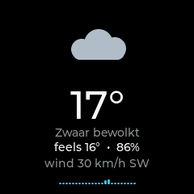

**图片：**上游屏幕截图。**说明：**ESP32-S3 / 1.28 英寸圆屏；外部 API 与配置需自行准备。**许可证：**MIT。

[查看源码](lvgl/ESP32-Sky-Gauge/) · [上游项目](https://github.com/Krasnov777/esp32-sky-gauge)

### 像素风桌面状态看板

**图片：**上游界面截图。**说明：**ESPHome / LVGL；需适配设备和数据来源。**许可证：**MIT。

[查看源码](lvgl/TokenTide/) · [上游项目](https://github.com/eldios/tokentide)

### 多主题智能家居面板

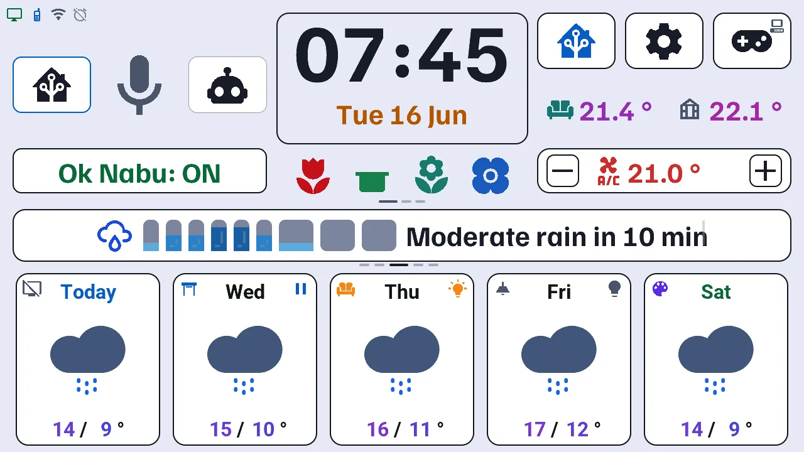

**图片：**上游 CI 渲染图。**说明：**M5Stack Tab5 / ESPHome / LVGL；图库图片多为 CI 渲染，字体有独立许可证。**许可证：**MIT。

[查看源码](lvgl/M5-Tab5-Home/) · [上游项目](https://github.com/Axellum/M5-Tab5-ESPHome-LVGL)

### 音乐播放控制面板

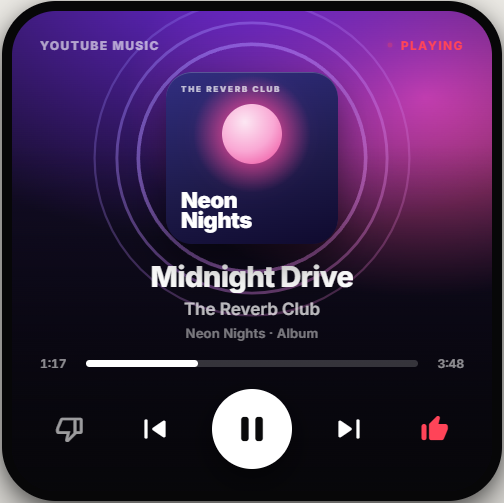

**图片：**上游预览图。**说明：**ESP32-S3 / LVGL 9.5 / ESP-IDF；控制 YouTube Music，非离线播放器。**许可证：**MIT。

[查看源码](lvgl/YT-Music-Companion/) · [上游项目](https://github.com/etaiso/yt-music-companion)

### 智能手表表盘、天气与应用

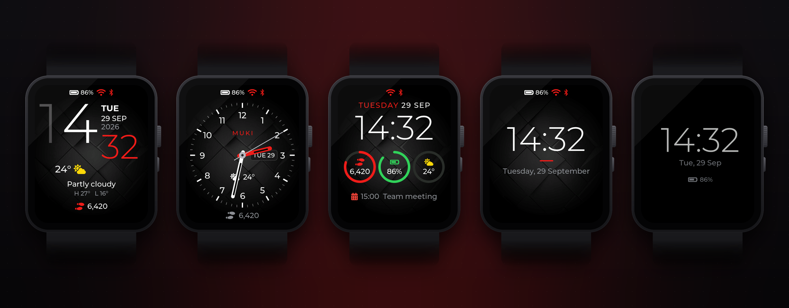

**图片：**上游预览图。**说明：**ESP32-S3 / LVGL 9.6 / Arduino；面向 Waveshare 1.8 英寸 AMOLED。**许可证：**MIT。

[查看源码](lvgl/Smartwatch-ESP32/) · [上游项目](https://github.com/muki01/Smartwatch-ESP32)

### 小组件、键盘与设置页

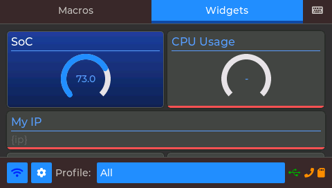

**图片：**上游界面截图。**说明：**ESP32 CYD / LVGL；板级子模块未包含，参见上游。**许可证：**MIT。

[查看源码](lvgl/CYD-Dashboard/) · [上游项目](https://github.com/ange007/CYD-Dashboard)

## 快照和依赖说明

- 仓库原有 DevicePilotHMI、LVGL-Car-Dashboard、ESP32-LVGL-Thermostat 未找到上游截图，仍可在首页和源码目录查阅。
- 每个项目的上游版本、图片位置和许可证记录在 [sources.json](sources.json)。本仓库存放源码快照，未导入原仓库 Git 历史。
- `PyQt-Dashboard` 排除上游的预编译 EXE，保留源码、截图和许可证。
- `LVGL-MCP-Examples` 的 LVGL 和 `CYD-Dashboard` 的 boards 是上游 Git 子模块，快照不包含子模块内容；完整构建请按上游说明递归获取。
- `S5W-Dial-QML` 含上游符号链接，Windows 检出时能否按原样创建取决于本机 Git 和系统设置。
- `E-Ink-Dashboard/src/main.cpp` 的上游注释含疑似 API 密钥，已从本快照注释中移除；功能代码和占位配置未改。
- `Car-Dashboard-CYD` 使用 GPL-3.0，复制、修改或分发时需遵守对应条款。
